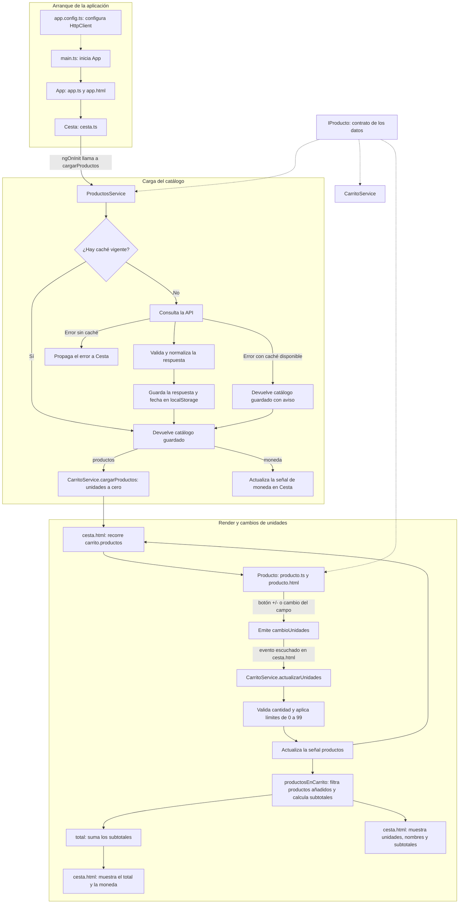

# Flujo de desarrollo de la cesta

Esta guía resume cómo se conectan los componentes y servicios del carrito, desde el arranque de Angular hasta la actualización del total.

## Orden para construir la funcionalidad

1. **Definir el modelo** en [`app/interfaces/iproducto.interfaces.ts`](app/interfaces/iproducto.interfaces.ts). `IProducto` establece los datos compartidos: identificador, nombre, precio, unidades y SKU opcional.
2. **Preparar los servicios**:
	 - [`app/services/productos.service.ts`](app/services/productos.service.ts) obtiene el catálogo desde la API o desde `localStorage`, valida la respuesta y la adapta a `IProducto`.
	 - [`app/services/carrito.service.ts`](app/services/carrito.service.ts) guarda los productos en señales, valida los cambios de unidades y calcula los subtotales y el total.
3. **Crear el componente de producto**. [`app/components/producto/producto.ts`](app/components/producto/producto.ts) recibe el producto y la moneda mediante inputs; emite `cambioUnidades` y convierte el valor escrito en el campo numérico. [`producto.html`](app/components/producto/producto.html) presenta sus datos y los controles `-`, cantidad y `+`.
4. **Orquestar la cesta**. [`app/components/cesta/cesta.ts`](app/components/cesta/cesta.ts) inyecta los servicios, mantiene la moneda y, en `ngOnInit`, carga el catálogo y lo inicializa en el carrito.
5. **Conectar la vista** en [`app/components/cesta/cesta.html`](app/components/cesta/cesta.html): recorre los productos, crea un `<app-producto>` por elemento, pasa sus datos y escucha `cambioUnidades` para llamar a `actualizarUnidades`.
6. **Arrancar la aplicación**. [`main.ts`](main.ts) inicia `App`; [`app.ts`](app/app.ts) incluye `Cesta` y [`app.html`](app/app.html) la muestra. [`app.config.ts`](app/app.config.ts) proporciona `HttpClient`, que necesita `ProductosService`.

## Diagrama del flujo

## Responsabilidad de cada pieza

| Archivo o clase | Responsabilidad |
| --- | --- |
| `main.ts`, `app.config.ts` | Iniciar Angular y registrar proveedores como `HttpClient`. |
| `App` | Componer la aplicación e incluir la cesta. |
| `IProducto` | Definir la forma común de cada producto. |
| `ProductosService` | Cargar, validar, normalizar y guardar en caché el catálogo. |
| `CarritoService` | Mantener el estado, cambiar unidades y calcular productos y total derivados. |
| `Cesta` | Coordinar la carga inicial, los servicios y la vista del carrito. |
| `Producto` | Mostrar un producto y emitir los cambios de cantidad al componente padre. |
| `cesta.html` y `producto.html` | Representar los datos y conectar los eventos de la interfaz. |

La dirección de los datos al cambiar una cantidad es: **control de `Producto` → evento `cambioUnidades` → `Cesta` → `CarritoService` → señales calculadas → actualización de `cesta.html`**.
