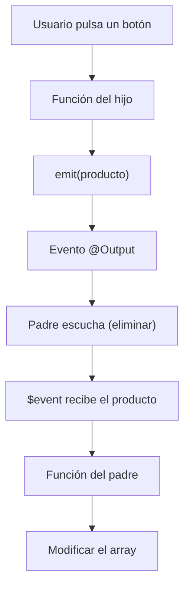

# Angular – Guía completa de desarrollo y lógica

Guía práctica de Angular para consultar durante el desarrollo de aplicaciones. Explica cómo estructurar componentes, comunicar información entre ellos, gestionar eventos, trabajar con formularios, modificar arrays, utilizar servicios y consumir APIs.

El objetivo es entender **qué hay que hacer, dónde hay que hacerlo y cómo se conecta cada parte**.

---

# 1. Entender cómo funciona Angular

Angular permite dividir una aplicación en componentes independientes.

Cada componente suele tener:

- **TypeScript (`.ts`):** contiene las variables, funciones y lógica.
- **HTML (`.html`):** muestra la información y permite interactuar con ella.
- **CSS (`.css`):** define los estilos.

Ejemplo de estructura:

```text
src/app/
├── components/
│   ├── listado/
│   ├── tarjeta/
│   └── formulario/
├── interfaces/
├── services/
├── app.ts
└── app.html
```

## ¿Qué responsabilidad tiene cada parte?

| Elemento | Responsabilidad |
|---|---|
| Componente principal | Organiza la aplicación y coordina los datos. |
| Componentes hijos | Muestran información y permiten realizar acciones. |
| Interfaces | Definen la estructura de los objetos. |
| Servicios | Comparten datos y lógica entre componentes. |
| HTML | Muestra los datos y conecta los eventos. |

**Regla general:** el TypeScript gestiona la lógica y el HTML muestra los datos y comunica las acciones del usuario.

# 2. Crear interfaces

Antes de trabajar con información, es recomendable definir cómo serán los objetos.

Por ejemplo, una interfaz para representar un producto:

```typescript
export interface IProducto {
  id: number;
  nombre: string;
  precio: number;
  categoria: string;
}
```

Después podemos utilizarla para declarar arrays:

```typescript
productos: IProducto[] = [];
```

O declarar una variable individual:

```typescript
productoSeleccionado: IProducto | null = null;
```

- `IProducto`: un objeto que cumple esa estructura.
- `IProducto[]`: un array de productos.
- `IProducto | null`: puede contener un producto o estar vacío.

# 3. Mostrar información en HTML

Angular permite conectar las variables del TypeScript con el HTML.

## 3.1. Interpolación: `{{ }}`

Se utiliza para mostrar el valor de una variable.

TypeScript:

```typescript
nombre = 'Teclado';
precio = 50;
```

HTML:

```html
<h2>{{ nombre }}</h2>
<p>{{ precio }} €</p>
```

## 3.2. Property Binding: `[propiedad]`

Se utiliza para pasar una variable a una propiedad HTML o de un componente.

```html

```

Es equivalente a asignar el valor de `producto.imagen` a la propiedad `src`.

## 3.3. Event Binding: `(evento)`

Se utiliza para ejecutar una función cuando sucede algo.

```html
<button (click)="eliminarProducto()">
  Eliminar
</button>
```

Cuando el usuario pulsa el botón, Angular ejecuta la función del TypeScript.

## 3.4. Two-way Binding: `[(ngModel)]`

Permite mantener sincronizado un campo HTML con una variable de TypeScript.

```html
<input type="text" [(ngModel)]="nombre">
```

Si el usuario escribe, cambia `nombre`. Si cambia `nombre` desde TypeScript, también se actualiza el input.

Hay que importar `FormsModule` en el componente que lo utiliza.

**Resumen de los enlaces:**

| Sintaxis | Función |
|---|---|
| `{{ variable }}` | Mostrar información. |
| `[propiedad]="variable"` | Enviar información a una propiedad. |
| `(evento)="funcion()"` | Ejecutar una función. |
| `[(ngModel)]="variable"` | Sincronizar variable e input. |

# 4. Recorrer arrays y mostrar información

Para mostrar varios elementos utilizamos `@for`.

TypeScript:

```typescript
productos: IProducto[] = [
  { id: 1, nombre: 'Teclado', precio: 50, categoria: 'Accesorios' },
  { id: 2, nombre: 'Ratón', precio: 30, categoria: 'Accesorios' }
];
```

HTML:

```html
@for (producto of productos; track producto.id) {
  <div>
    <h3>{{ producto.nombre }}</h3>
    <p>{{ producto.precio }} €</p>
  </div>
}
```

- `producto of productos`: recorre el array.
- `producto`: representa el elemento actual.
- `track producto.id`: identifica cada elemento de forma única.

## Mostrar contenido según una condición

Utilizamos `@if`:

```html
@if (productos.length > 0) {
  <p>Hay productos disponibles.</p>
} @else {
  <p>No hay productos.</p>
}
```

También podemos utilizar condiciones:

```html
@if (producto.precio > 100) {
  <span>Producto caro</span>
}
```

# 5. Comunicación entre componentes

Esta es una de las partes más importantes de Angular.

Cuando tenemos componentes padre e hijo, necesitamos comunicar información entre ellos.

Existen dos direcciones:

- **Padre → Hijo:** `@Input()`.
- **Hijo → Padre:** `@Output()` + `EventEmitter` + `emit()`.

## 5.1. Padre → Hijo: @Input()

Se utiliza cuando un componente necesita enviar información a otro.

**Paso 1.** El componente padre tiene los datos:

```typescript
productos: IProducto[] = [];
```

**Paso 2.** En el HTML del padre enviamos la información:

```html
<app-listado [productos]="productos"></app-listado>
```

La sintaxis `[productos]` indica que estamos pasando una variable.

**Paso 3.** El componente hijo recibe esa información:

```typescript
@Input() productos: IProducto[] = [];
```

Ahora el hijo puede utilizar `productos` en su propio HTML:

```html
@for (producto of productos; track producto.id) {
  <p>{{ producto.nombre }}</p>
}
```

**Esquema:**

```mermaid
flowchart TD
    A[Componente padre] -->|[productos]="productos"| B[Componente hijo]
    B --> C["@Input() productos"]
    C --> D[Utilizar los datos en el HTML]
```

Importante: el padre es quien proporciona los datos. El hijo los recibe.

## 5.2. Hijo → Padre: @Output()

Se utiliza cuando el hijo necesita comunicar una acción o enviar información al padre.

Por ejemplo, el hijo tiene un botón para eliminar un producto, pero queremos que el padre sea quien modifique el array.

**Paso 1.** Importar `Output` y `EventEmitter`:

```typescript
import { Component, Output, EventEmitter } from '@angular/core';
```

**Paso 2.** Crear el evento:

```typescript
@Output() eliminar = new EventEmitter<IProducto>();
```

Esto significa que el componente podrá emitir un evento llamado `eliminar` que transportará un objeto `IProducto`.

**Paso 3.** Crear una función que emita el evento:

```typescript
eliminarProducto() {
  this.eliminar.emit(this.producto);
}
```

Aquí tenemos tres elementos importantes:

- `@Output()`: declara un evento que el padre puede escuchar.
- `EventEmitter<IProducto>`: establece el tipo de información que se enviará.
- `.emit()`: lanza el evento y envía la información.

**Paso 4.** En el HTML del hijo conectamos el botón:

```html
<button (click)="eliminarProducto()">
  Eliminar
</button>
```

**Paso 5.** En el HTML del padre escuchamos el evento:

```html
<app-tarjeta
  [producto]="producto"
  (eliminar)="eliminarProducto($event)">
</app-tarjeta>
```

**Paso 6.** En el TypeScript del padre recibimos la información:

```typescript
eliminarProducto(producto: IProducto) {
  this.productos = this.productos.filter(
    p => p.id !== producto.id
  );
}
```

## 5.3. ¿Qué es exactamente $event?

`$event` representa el dato que ha enviado el componente hijo mediante `emit()`.

Por ejemplo:

```typescript
this.eliminar.emit(this.producto);
```

El padre recibe ese mismo producto:

```html
(eliminar)="eliminarProducto($event)"
```

Y lo recoge en el parámetro de la función:

```typescript
eliminarProducto(producto: IProducto) {
  // Aquí tenemos el producto enviado.
}
```

Por tanto, el recorrido es:



## 5.4. ¿Qué ocurre si hay varios componentes?

Imagina esta estructura:

```text
App
└── Catalogo
    └── TarjetaProducto
```

Si `TarjetaProducto` quiere enviar un evento a `App`, el evento no sube automáticamente por todos los componentes.

El componente intermedio (`Catalogo`) debe recibirlo y volver a emitirlo.

En `TarjetaProducto`:

```typescript
@Output() anadir = new EventEmitter<IProducto>();

anadirProducto() {
  this.anadir.emit(this.producto);
}
```

En el HTML de `Catalogo`:

```html
<app-tarjeta-producto
  [producto]="producto"
  (anadir)="anadir.emit($event)">
</app-tarjeta-producto>
```

En el TypeScript de `Catalogo`:

```typescript
@Output() anadir = new EventEmitter<IProducto>();
```

Finalmente, en `App`:

```html
<app-catalogo
  [productos]="productos"
  (anadir)="anadirAlCarrito($event)">
</app-catalogo>
```

**Idea importante:** el componente que recibe un evento puede gestionarlo o volver a emitirlo.

# 6. Trabajar con arrays: las operaciones más utilizadas

En muchos ejercicios de Angular, la lógica consiste en consultar, añadir, modificar o eliminar elementos de un array.

Vamos a utilizar:

```typescript
productos: IProducto[] = [];
```

## 6.1. Añadir: push()

Añade un elemento al final del array.

```typescript
this.productos.push(producto);
```

También podemos crear un nuevo array:

```typescript
this.productos = [...this.productos, producto];
```

## 6.2. Buscar: find()

Devuelve el primer elemento que cumple una condición.

```typescript
const encontrado = this.productos.find(
  p => p.id === id
);
```

Si no encuentra ninguno, devuelve `undefined`.

Se utiliza para comprobar si un elemento existe.

```typescript
if (encontrado) {
  // El elemento existe.
}
```

## 6.3. Buscar posición: findIndex()

Devuelve la posición del primer elemento que cumple una condición.

```typescript
const indice = this.productos.findIndex(
  p => p.id === id
);
```

Si no existe, devuelve `-1`.

```typescript
if (indice !== -1) {
  // Se ha encontrado.
}
```

## 6.4. Eliminar: filter()

Crea un nuevo array con los elementos que cumplen una condición.

Para eliminar un producto por su ID:

```typescript
this.productos = this.productos.filter(
  p => p.id !== id
);
```

¿Por qué `!==`?

Porque queremos conservar todos los productos cuyo ID sea diferente al que queremos eliminar.

## 6.5. Modificar: map()

Recorre un array y devuelve uno nuevo con los elementos transformados.

Para modificar un producto:

```typescript
this.productos = this.productos.map(p =>
  p.id === producto.id ? producto : p
);
```

Esto significa:

- Si el ID coincide, devuelve el producto actualizado.
- Si no coincide, devuelve el producto original.

También podemos modificar solamente una propiedad:

```typescript
this.productos = this.productos.map(p =>
  p.id === id ? { ...p, nombre: 'Nuevo nombre' } : p
);
```

## 6.6. Recorrer: forEach()

Ejecuta una función para cada elemento del array.

```typescript
this.productos.forEach(p => {
  console.log(p.nombre);
});
```

No crea un nuevo array.

## 6.7. Obtener un total: reduce()

Permite acumular valores de un array.

Por ejemplo, sumar los precios:

```typescript
const total = this.productos.reduce(
  (acumulador, p) => acumulador + p.precio,
  0
);
```

## Resumen de arrays

| Método | Para qué sirve | ¿Devuelve array nuevo? |
|---|---|---|
| `push()` | Añadir | No |
| `find()` | Buscar elemento | No |
| `findIndex()` | Buscar posición | No |
| `filter()` | Filtrar o eliminar | Sí |
| `map()` | Transformar o modificar | Sí |
| `forEach()` | Recorrer | No |
| `reduce()` | Acumular valores | No, devuelve un resultado |

**Consejo:** cuando necesites eliminar o actualizar elementos por ID, normalmente `filter()` y `map()` son las opciones más cómodas.

# 7. Formularios y ngModel

Los formularios permiten recoger información del usuario.

Para utilizar `[(ngModel)]`, necesitamos importar `FormsModule`.

## 7.1. Crear variables para el formulario

```typescript
nombre = '';
precio = 0;
categoria = '';
```

## 7.2. Enlazar los campos HTML

```html
<input
  type="text"
  name="nombre"
  [(ngModel)]="nombre"
>

<input
  type="number"
  name="precio"
  [(ngModel)]="precio"
>
```

El atributo `name` identifica el campo dentro de un formulario de Angular.

## 7.3. Crear una función para guardar

```typescript
guardarProducto() {
  const nuevoProducto: IProducto = {
    id: 0,
    nombre: this.nombre,
    precio: this.precio,
    categoria: this.categoria
  };

  this.productos.push(nuevoProducto);
}
```

## 7.4. Conectar el formulario

```html
<form (ngSubmit)="guardarProducto()">
  <input
    type="text"
    name="nombre"
    [(ngModel)]="nombre"
  >

  <button type="submit">Guardar</button>
</form>
```

El evento `(ngSubmit)` ejecuta la función al enviar el formulario.

# 8. Crear y editar con el mismo formulario

Una situación muy habitual es utilizar el mismo formulario para crear y editar.

Para ello necesitamos una variable que indique si estamos editando:

```typescript
elementoSeleccionado: IProducto | null = null;
```

## 8.1. Seleccionar un elemento para editar

Cuando el usuario pulsa editar:

```typescript
editarProducto(producto: IProducto) {
  this.elementoSeleccionado = { ...producto };
}
```

¿Por qué utilizamos `{ ...producto }`?

Para crear una copia del objeto. Así podemos modificar el formulario sin alterar directamente el elemento original antes de guardar.

## 8.2. Cargar los datos en el formulario

Si utilizamos `[(ngModel)]`:

```html
<input
  type="text"
  name="nombre"
  [(ngModel)]="elementoSeleccionado.nombre"
>
```

En la práctica, si la variable puede ser `null`, es mejor utilizar variables propias para el formulario o comprobar que el objeto existe antes de acceder a sus propiedades.

## 8.3. Guardar según el modo

Podemos comprobar si estamos creando o editando:

```typescript
guardarProducto() {
  if (this.elementoSeleccionado) {
    // Actualizar el producto.
  } else {
    // Crear un producto nuevo.
  }
}
```

Para actualizar:

```typescript
this.productos = this.productos.map(p =>
  p.id === productoActualizado.id
    ? productoActualizado
    : p
);
```

Para terminar la edición:

```typescript
this.elementoSeleccionado = null;
```

## 8.4. Cancelar la edición

Simplemente limpiamos la selección:

```typescript
cancelarEdicion() {
  this.elementoSeleccionado = null;
}
```

# 9. Servicios e inyección de dependencias

Los servicios permiten compartir lógica y datos entre varios componentes.

Por ejemplo, si el carrito se utiliza en diferentes partes de la aplicación, no tiene sentido repetir toda su lógica en cada componente.

## 9.1. Crear un servicio

```typescript
import { Injectable } from '@angular/core';

@Injectable({
  providedIn: 'root'
})
export class CarritoService {

  productos: IProducto[] = [];

  agregar(producto: IProducto) {
    this.productos.push(producto);
  }

  obtenerProductos() {
    return this.productos;
  }
}
```

`providedIn: 'root'` permite que Angular proporcione una instancia compartida del servicio en la aplicación.

## 9.2. Inyectar el servicio

En el componente:

```typescript
import { inject } from '@angular/core';

private carritoService = inject(CarritoService);
```

Ahora podemos utilizar sus métodos:

```typescript
agregarProducto(producto: IProducto) {
  this.carritoService.agregar(producto);
}
```

## 9.3. ¿Cuándo utilizar un servicio?

Utiliza un servicio cuando:

- Varios componentes necesitan acceder a los mismos datos.
- Quieres centralizar la lógica.
- Necesitas compartir el estado de un carrito.
- Necesitas realizar peticiones HTTP.
- Quieres evitar repetir código.

**Diferencia importante:**

- `@Input()` y `@Output()` comunican componentes relacionados.
- Los servicios permiten compartir información y lógica entre componentes sin depender de una relación directa padre-hijo.

# 10. Signals: estado reactivo

Los Signals permiten guardar información reactiva.

Cuando cambia un Signal, Angular puede actualizar los lugares de la interfaz que dependen de él.

## 10.1. Crear un Signal

```typescript
import { signal } from '@angular/core';

contador = signal(0);
```

## 10.2. Leer su valor

```typescript
this.contador();
```

En HTML:

```html
<p>{{ contador() }}</p>
```

## 10.3. Modificar su valor

Con `set()` establecemos un valor:

```typescript
this.contador.set(10);
```

Con `update()` calculamos el nuevo valor a partir del anterior:

```typescript
this.contador.update(valor => valor + 1);
```

## 10.4. Signals con arrays

```typescript
productos = signal<IProducto[]>([]);
```

Añadir:

```typescript
this.productos.update(lista => [
  ...lista,
  nuevoProducto
]);
```

Eliminar:

```typescript
this.productos.update(lista =>
  lista.filter(p => p.id !== id)
);
```

## 10.5. Computed

`computed()` permite calcular un valor a partir de otros Signals.

```typescript
import { signal, computed } from '@angular/core';

precio = signal(100);
unidades = signal(2);

subtotal = computed(() =>
  this.precio() * this.unidades()
);
```

En HTML:

```html
<p>{{ subtotal() }} €</p>
```

Si cambia el precio o las unidades, el subtotal se recalcula automáticamente.

# 11. Consumir APIs con HttpClient

Cuando los datos vienen de un servidor, utilizamos `HttpClient`.

## 11.1. Configurar HttpClient

En una aplicación standalone se configura normalmente en `app.config.ts`:

```typescript
import { provideHttpClient } from '@angular/common/http';

export const appConfig = {
  providers: [
    provideHttpClient()
  ]
};
```

## 11.2. Crear un servicio para la API

```typescript
import { Injectable, inject } from '@angular/core';
import { HttpClient } from '@angular/common/http';

@Injectable({
  providedIn: 'root'
})
export class ProductosService {

  private http = inject(HttpClient);

  private url = 'https://api.ejemplo.com/productos';

  obtenerProductos() {
    return this.http.get<IProducto[]>(this.url);
  }
}
```

`http.get()` realiza una petición GET y devuelve un Observable.

## 11.3. Recibir los datos

En el componente podemos suscribirnos:

```typescript
productos: IProducto[] = [];

cargarProductos() {
  this.productosService.obtenerProductos().subscribe({
    next: (datos) => {
      this.productos = datos;
    },
    error: (error) => {
      console.error(error);
    }
  });
}
```

- `next`: se ejecuta cuando llega correctamente la respuesta.
- `error`: se ejecuta cuando ocurre un error.

## 11.4. Operaciones HTTP

| Método | Operación | Uso |
|---|---|---|
| GET | Obtener | Consultar datos. |
| POST | Crear | Enviar un objeto nuevo. |
| PUT | Actualizar | Sustituir o actualizar un recurso. |
| PATCH | Modificar | Actualizar parcialmente. |
| DELETE | Eliminar | Borrar un recurso. |

Ejemplos:

```typescript
obtener() {
  return this.http.get<IProducto[]>(this.url);
}

crear(producto: IProducto) {
  return this.http.post<IProducto>(this.url, producto);
}

actualizar(id: number, producto: IProducto) {
  return this.http.put<IProducto>(`${this.url}/${id}`, producto);
}

eliminar(id: number) {
  return this.http.delete(`${this.url}/${id}`);
}
```

# 12. Cómo resolver un ejercicio de Angular paso a paso

Cuando te entreguen un enunciado, no empieces directamente a escribir código. Sigue este orden:

## Paso 1. Identificar los datos

Pregúntate:

- ¿Qué objetos voy a manejar?
- ¿Qué propiedades tiene cada objeto?
- ¿Necesito uno o varios arrays?
- ¿Necesito guardar un elemento seleccionado?

Crea las interfaces.

## Paso 2. Identificar los componentes

Divide la interfaz en partes.

Por ejemplo:

```text
App
├── Listado
│   └── Tarjeta
└── Formulario
```

Piensa qué responsabilidad tendrá cada componente.

## Paso 3. Decidir dónde se guardan los datos

Identifica qué componente debe controlar cada array.

Como punto de partida, guarda los datos en el componente padre y pásalos a los hijos mediante `@Input()`.

Si varios componentes necesitan compartirlos, considera utilizar un servicio.

## Paso 4. Conectar los componentes

Para cada comunicación, pregúntate:

- ¿El padre envía información al hijo? → `@Input()`.
- ¿El hijo necesita avisar al padre? → `@Output()`.
- ¿Tiene que enviar un dato? → `EventEmitter<T>`.
- ¿Cómo lo envía? → `.emit(dato)`.
- ¿Cómo lo recibe el padre? → `$event`.

## Paso 5. Crear las funciones

Identifica las operaciones que pide el enunciado:

| Acción del usuario | Función habitual |
|---|---|
| Añadir | `agregarElemento()` |
| Eliminar | `eliminarElemento()` |
| Editar | `editarElemento()` |
| Guardar | `guardarElemento()` |
| Cancelar | `cancelarEdicion()` |
| Filtrar | `filtrarElementos()` |
| Buscar | `buscarElemento()` |
| Cambiar estado | `cambiarEstado()` |

## Paso 6. Conectar el HTML

Utiliza:

- `{{ }}` para mostrar información.
- `[]` para pasar datos.
- `()` para escuchar eventos.
- `[(ngModel)]` para formularios.
- `@for` para recorrer arrays.
- `@if` para condiciones.

## Paso 7. Comprobar el funcionamiento

Prueba cada operación:

- ¿Se muestran los datos?
- ¿Se añade correctamente?
- ¿Se elimina el elemento correcto?
- ¿Se actualiza sin duplicar?
- ¿El formulario se limpia?
- ¿Los componentes reciben los datos?
- ¿Los eventos llegan al componente correcto?

---

# 13. Diagrama general de comunicación

Este es el esquema que resume la mayoría de ejercicios con componentes:

```mermaid
flowchart TD
    A[Componente padre] -->|@Input: envía datos| B[Componente hijo]
    B --> C[Usuario realiza una acción]
    C --> D[Se ejecuta una función]
    D --> E["emit(datos)"]
    E --> F["@Output: evento"]
    F --> G["$event"]
    G --> H[Función del padre]
    H --> I[Actualizar datos]
    I --> J[Angular actualiza la vista]
```

# 14. Chuleta rápida para el examen

| Si necesitas... | Utiliza... |
|---|---|
| Mostrar una variable | `{{ variable }}` |
| Pasar información al hijo | `@Input()` |
| Enviar un evento al padre | `@Output()` |
| Crear un evento | `new EventEmitter<T>()` |
| Enviar información con un evento | `this.evento.emit(dato)` |
| Recibir el dato enviado | `$event` |
| Recorrer un array | `@for` |
| Comprobar una condición | `@if` |
| Enlazar un input | `[(ngModel)]` |
| Añadir un elemento | `push()` |
| Buscar un elemento | `find()` |
| Buscar una posición | `findIndex()` |
| Eliminar por ID | `filter()` |
| Modificar por ID | `map()` |
| Compartir lógica | Servicio |
| Obtener un servicio | `inject()` |
| Crear estado reactivo | `signal()` |
| Calcular valores reactivos | `computed()` |
| Consultar una API | `HttpClient` |
| Recibir una respuesta Observable | `subscribe()` |

---

**La idea fundamental de Angular:**

1. El componente padre controla o coordina los datos.
2. Los hijos reciben información mediante `@Input()`.
3. Los hijos comunican acciones mediante `@Output()`.
4. `EventEmitter` crea el evento y `emit()` envía el dato.
5. `$event` permite recoger ese dato desde el padre.
6. El componente o servicio correspondiente ejecuta la lógica.
7. Angular actualiza la interfaz cuando cambian los datos enlazados.

Si entiendes este flujo, puedes construir la lógica de muchos ejercicios distintos sin depender de memorizar un proyecto concreto.
